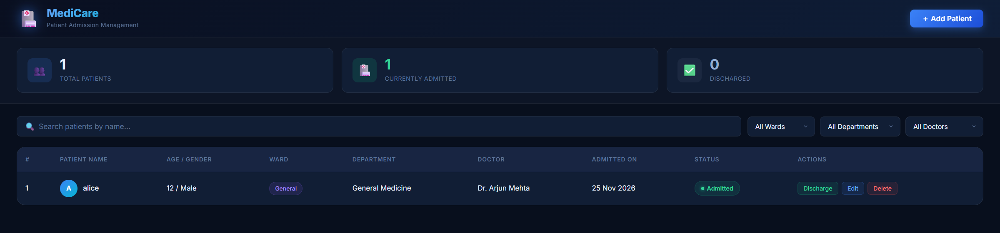
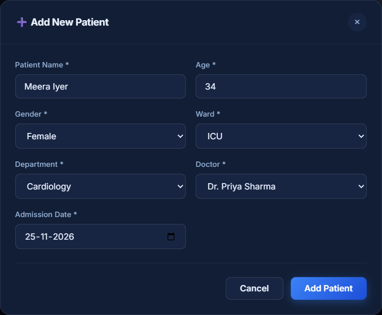
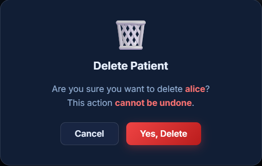

# MediCare — Patient Admission Management App

A full-stack web application for hospital staff to manage admitted patients. Built with **React.js** (frontend) and **Java Spring Boot** (backend) with **MySQL** database.

---

## 🔗 Live Links

- **Frontend (Live):** [https://frontend-seven-steel-26.vercel.app](https://frontend-seven-steel-26.vercel.app)
- **Backend API (Live):** [https://medicareapp-production.up.railway.app](https://medicareapp-production.up.railway.app)
- **GitHub Repo:** [https://github.com/Nithyashree26-KN/MediCareApp](https://github.com/Nithyashree26-KN/MediCareApp)

---

## 🛠️ Tech Stack

| Layer      | Technology                        |
|------------|-----------------------------------|
| Frontend   | React.js (Vite)                   |
| Backend    | Java 17, Spring Boot 3.2          |
| Database   | MySQL (local) / MySQL (Railway)   |
| ORM        | Spring Data JPA / Hibernate       |
| Validation | Bean Validation (javax.validation)|
| Deployment | Vercel (frontend) + Railway (backend + DB) |

---

## ✨ Features (All Mandatory — Implemented)

1. ✅ **Add a patient** — Modal form with all 8 fields
2. ✅ **View list of all patients** — Responsive table with status badges
3. ✅ **Filter by Ward, Department, and Doctor** — Dropdown filters
4. ✅ **Search patients by name** — Real-time search
5. ✅ **Edit a patient** — Pre-filled edit modal
6. ✅ **Delete a patient (with confirmation)** — Confirmation dialog before deletion
7. ✅ **Mark a patient as Discharged** — Status toggle with visual badge
8. ✅ **Clean responsive design** — Works on mobile, tablet, and desktop

---

## 📋 Patient Fields

| Field           | Type                    |
|-----------------|-------------------------|
| Name            | Text (letters only)     |
| Age             | Number (0–120)          |
| Gender          | Select (Male/Female/Other) |
| Ward            | Select (General, ICU, Pediatric, Maternity, Surgical, Orthopedic) |
| Department      | Select (Cardiology, Neurology, Orthopedics, Pediatrics, General Medicine, Oncology, Gynecology) |
| Doctor          | Select (Dr. Arjun Mehta, Dr. Priya Sharma, Dr. Rahul Nair, Dr. Sunita Rao, Dr. Vikram Das) |
| Admission Date  | Date (cannot be future) |
| Status          | Admitted / Discharged   |

---

## ✅ Validation (Both Frontend AND Backend)

| Field             | Frontend                        | Backend                              |
|-------------------|---------------------------------|--------------------------------------|
| Name              | Required, letters + spaces only | `@NotBlank`, `@Pattern("[a-zA-Z ]+")` |
| Age               | Required, 0–120                 | `@NotNull`, `@Min(0)`, `@Max(120)`   |
| Gender/Ward/Dept/Doctor | Required, select from list | `@NotBlank`                          |
| Admission Date    | Required, ≤ today               | `@NotNull`, `@PastOrPresent`         |
| Backend errors    | —                               | Returns clear JSON error messages    |

---

## 🗂️ Project Structure

```
MediCareApp/
├── backend/                          # Spring Boot REST API
│   ├── src/main/java/com/hospital/patient/
│   │   ├── PatientManagementApplication.java   # Main app
│   │   ├── model/Patient.java                  # JPA Entity
│   │   ├── repository/PatientRepository.java   # Data access
│   │   ├── service/PatientService.java         # Business logic
│   │   ├── controller/PatientController.java   # REST endpoints
│   │   ├── config/CorsConfig.java              # CORS settings
│   │   └── exception/                          # Error handling
│   ├── src/main/resources/
│   │   └── application.properties              # DB config
│   └── pom.xml                                 # Maven dependencies
│
├── frontend/                         # React.js (Vite)
│   ├── src/
│   │   ├── App.jsx                             # Main app
│   │   ├── api/patients.js                     # Axios API calls
│   │   ├── components/
│   │   │   ├── PatientForm.jsx                 # Add/Edit form
│   │   │   ├── PatientTable.jsx                # Patient list table
│   │   │   ├── FilterBar.jsx                   # Ward/Dept/Doctor filters
│   │   │   └── DeleteModal.jsx                 # Delete confirmation
│   │   ├── index.css                           # Design system
│   │   └── App.css                             # Component styles
│   └── package.json                            # NPM dependencies
│
└── README.md
```

---

## 🚀 How to Run Locally

### Prerequisites
- Java 17+
- Node.js 18+
- MySQL running on localhost:3306

### Backend
```bash
cd backend
# Update application.properties with your MySQL credentials
mvn spring-boot:run
# Server starts at http://localhost:8080
```

### Frontend
```bash
cd frontend
npm install
npm run dev
# App opens at http://localhost:5173
```

---

## 📡 REST API Endpoints

| Method | Endpoint                       | Description          |
|--------|--------------------------------|----------------------|
| GET    | `/`                            | API health check     |
| GET    | `/api/patients`                | List all patients    |
| GET    | `/api/patients?ward=ICU`       | Filter by ward       |
| GET    | `/api/patients?department=...` | Filter by department |
| GET    | `/api/patients?doctor=...`     | Filter by doctor     |
| GET    | `/api/patients?search=name`    | Search by name       |
| POST   | `/api/patients`                | Add new patient      |
| PUT    | `/api/patients/{id}`           | Edit patient         |
| DELETE | `/api/patients/{id}`           | Delete patient       |
| PATCH  | `/api/patients/{id}/discharge` | Mark as discharged   |

---

## 📸 Screenshots

### Patient List View
The main dashboard shows all admitted patients in a responsive table with status badges, search, and filter options.



### Add/Edit Patient Form
A modal form with real-time validation for all 8 fields including dropdown selections.



### Delete Confirmation
A confirmation dialog appears before deleting any patient record.



---

## 👩‍💻 Author

**Nithyashree** — [GitHub](https://github.com/Nithyashree26-KN)
